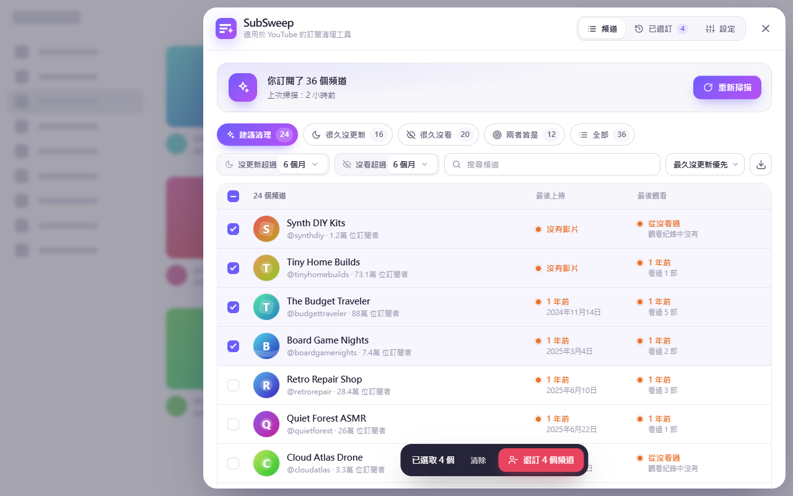

# SubSweep – 適用於 YouTube 的訂閱清理工具


Chrome／Edge／Firefox 瀏覽器擴充功能：列出你訂閱的 YouTube 頻道，找出**很久沒更新**、或你**很久沒看**的頻道，勾選後一次批次退訂。

- 不使用任何付費 API，也不需要申請 Google Cloud 專案
- 不需要使用者匯出 Takeout（但可以選擇匯入當備用方案）
- 所有資料只存在使用者的瀏覽器裡
- 同一份程式碼支援 Chrome／Edge（111 以上）和 Firefox 電腦版（140 以上）
- 介面支援 5 種語言（English、繁體中文、简体中文、日本語、한국어），依瀏覽器語言自動切換
- 支援淺色／深色主題（跟隨 YouTube 的主題設定）



---

## 目錄結構

```
extension/                    ← 插件本體（Chrome／Edge 可以直接載入這個資料夾）
  manifest.json               Chrome 用的 manifest；Firefox 版由打包工具自動轉換（tools/lib/targets.mjs）
  _locales/<語言>/messages.json   5 種語言的介面文字
  icons/                      工具列圖示（由 npm run assets 產生）
  src/background.js           工具列按鈕：開關面板／開啟 YouTube
  src/bridge.js               在 YouTube 頁面內（MAIN world）代送請求的橋接程式
  src/content/
    core.js                   共用工具：i18n、日期格式、DOM 建構
    parse.js                  解析 YouTube 回應（純函式，有測試）
    filters.js                篩選、排序、CSV 匯出（純函式，有測試）
    youtube.js                讀訂閱、觀看紀錄、最新上傳；退訂／重新訂閱
    store.js                  storage.local 讀寫
    app.js                    狀態與流程：掃描、批次退訂、復原、匯入匯出
    panel.js                  介面（Shadow DOM，不會和 YouTube 的樣式互相干擾）
    styles.js / icons.js      樣式與圖示
    main.js                   進入點
store/
  PUBLISHING.md               ★ Chrome 線上應用程式商店：上架步驟與後台要貼的文字
  PUBLISHING-firefox.md       ★ Firefox Add-ons：上架步驟與後台要貼的文字
  listing/<語言>.md           各語言的商店說明
  assets/                     商店圖示、截圖、宣傳圖（由 npm run assets 產生）
tests/                        單元測試（node:test）；browser/ 瀏覽器測試；smoke-hooks/ Firefox 煙霧測試用的掛鉤（不會打包進正式版）
tools/                        截圖／素材產生、打包、煙霧測試；lib/chrome.mjs、lib/firefox.mjs 是無頭瀏覽器的控制程式
PRIVACY.md                    隱私權政策（英文＋繁中）；網頁版由 npm run privacy 產生
```

---

## 運作原理

| 功能 | 資料來源 |
| --- | --- |
| 訂閱清單 | YouTube「所有訂閱內容」頁面使用的內部請求（`browse` / `FEchannels`） |
| 頻道最後上傳時間 | 頻道的公開 RSS（`/feeds/videos.xml`），失敗時改讀頻道的「影片」分頁（2026 年 11 月測試時 YouTube 的 RSS 全面回傳 404，目前實際上都走「影片」分頁） |
| 最後觀看時間 | YouTube「觀看記錄」頁面使用的內部請求（`browse` / `FEhistory`），依日期標題判斷每部影片是哪天看的 |
| 退訂／重新訂閱 | 和你在 YouTube 按「取消訂閱」時送出的請求相同（`subscription/unsubscribe`） |

- `bridge.js` 跑在 YouTube 頁面本身的環境中，用頁面的登入狀態送出請求，就像 YouTube 網頁自己在操作一樣。它只允許 3 個固定的端點，請求只會送往 `www.youtube.com`。
- **掃描速度**：
  - 觀看紀錄和最新上傳**同時進行**。總時間是兩者中較久的那個，不是兩者相加。
  - 最新上傳一次同時查 6 個頻道。
  - 觀看紀錄和訂閱清單是「一頁接一頁」的鏈（每一頁才告訴你下一頁在哪），本身沒辦法併發，每頁之間只停 0.1 秒。
- **觀看紀錄只讀需要的部分**：
  - 第一次掃描讀設定範圍內（預設 12 個月）的紀錄；之後只讀上次之後新增的部分，通常幾秒鐘。
  - **擴大範圍**（例如 6 → 12 個月）時：先讀最新的部分，再從上次讀到的盡頭直接接著讀多出來的月份，中間已讀過的不重讀。如果那個位置已被 YouTube 拒絕（隔太久失效），就改讀整個範圍，結果仍然正確。
- **掃描可以暫停、之後接著做**：
  - 觀看紀錄每讀完一頁就存檔（單獨的小儲存項目），連關掉或重新整理分頁也不會白做。
  - 下次掃描會先補讀暫停之後新增的紀錄，再從中斷的那一頁繼續。
  - 6 小時內抓過的訂閱清單直接沿用；已經查過的頻道上傳時間也會跳過。
  - 存檔的位置如果被 YouTube 拒絕，會自動改從頭讀，結果仍然正確。
- **插件更新後**：已開著的 YouTube 分頁裡跑的還是舊版。舊版一偵測到自己過期，就會停下手邊的工作，並提示「SubSweep 已更新，請重新整理頁面」；已存的進度會保留。如果直接按工具列圖示，則會自動換成新版。
- **退訂速度**（設定 →「速度」）：
  - **快速**（預設）：每 20 個頻道一個請求，送完後重新讀一次訂閱清單，以 YouTube 的實際狀態確認結果。沒確認到的頻道自動改成逐一處理。如果發現 YouTube 不接受批次，會記住並改用逐一模式。只有在預估比逐一處理快時才會用批次：訂閱很多、但只退訂幾個時，確認一次反而比較慢。
  - **一般**：一個一個處理，間隔 0.7～1.3 秒。
  - **溫和**：一個一個處理，間隔 2.5～4 秒。
  - 逐一處理時，遇到 YouTube 限流或錯誤會自動放慢；連續失敗 3 次就停止。隨時可以按「停止」。
- **工具列按鈕**：
  - 在 YouTube 分頁上按：直接開關面板。
  - 在其他分頁按，而且已經有開著的 YouTube 分頁：切換過去開啟面板，不開新分頁。
  - 完全沒有 YouTube 分頁：開一個 YouTube **首頁**的新分頁。不開「所有訂閱內容」頁，因為訂閱很多時那頁很慢。
  - SubSweep 安裝或更新前就開著的 YouTube 分頁，會直接注入程式（`scripting` 權限），不用重新整理。
- **大量訂閱**：清單先畫 80 列，捲到底部附近再自動補上，所以開啟和篩選的速度不受訂閱數量影響。實測 3000 個頻道：開啟面板 1.3 秒 → 0.23 秒，頁面最長卡頓 1.2 秒 → 0.12 秒。
- 資料依 YouTube 帳號分開儲存（使用帳號 ID 的雜湊值），切換帳號不會混在一起。

---

## 開發

需要 **Node.js 22 以上**（只用到內建模組，不需要 `npm install`）和 Chrome。有安裝 Firefox 的話，測試和打包也會一併在 Firefox 執行。

### 在 Chrome 載入插件

1. 開啟 `chrome://extensions`
2. 打開右上角的「**開發人員模式**」
3. 點「**載入未封裝項目**」，選擇專案裡的 `extension` 資料夾
4. 開啟 <https://www.youtube.com>，點工具列上的 SubSweep 圖示（建議先把它釘選在工具列）

修改程式碼後：在 `chrome://extensions` 按 SubSweep 的重新載入按鈕，再**重新整理 YouTube 分頁**。

### 在 Firefox 載入插件

1. 執行 `npm run build`，產生 `dist/firefox/`（Firefox 用的 manifest 和 Chrome 不同，所以不能直接載入 `extension` 資料夾）
2. 在 Firefox 網址列輸入 `about:debugging` →「**This Firefox（這個 Firefox）**」
3. 點「**Load Temporary Add-on…（載入暫時附加元件）**」，選 `dist/firefox/manifest.json`
4. 開啟 <https://www.youtube.com>，點工具列上的 SubSweep 圖示（在「擴充套件」拼圖按鈕裡，可以釘選到工具列）

暫時載入的附加元件**關掉 Firefox 就會消失**，只適合開發測試。要給別人長期使用，必須經過 Mozilla 簽署，請看 [`store/PUBLISHING-firefox.md`](store/PUBLISHING-firefox.md)。修改程式碼後：重新執行 `npm run build`，在 `about:debugging` 按 SubSweep 的「重新載入」，再重新整理 YouTube 分頁。

### 常用指令

| 指令 | 用途 |
| --- | --- |
| `npm test` | 單元測試：解析器、篩選邏輯、5 種語言的翻譯是否一致、商店字數限制、manifest 檔案是否齊全 |
| `npm run test:browser` | 瀏覽器測試（無頭瀏覽器 + 假的 YouTube）。預設用 Chrome；`npm run test:browser -- firefox` 用 Firefox，`-- all` 兩個都跑。內容：暫停後續掃、重新整理後續掃、存檔位置失效時從頭讀、擴大範圍只補讀多出來的月份、觀看紀錄與上傳同時進行、快速模式的 3 種批次情境、分頁在背景時批次退訂、重新整理後接續未完成的退訂 |
| `npm run lint` | 檢查所有 JS 語法和 JSON 格式 |
| `npm run assets` | 用無頭 Chrome 產生圖示、5 種語言的商店截圖和宣傳圖 |
| `npm run build` | 產生可直接載入的未封裝版本：`dist/chrome/`、`dist/firefox/` |
| `npm run package` | 跑完檢查與測試（有安裝 Firefox 時，瀏覽器測試也會在 Firefox 跑一次）後打包：`dist/subsweep-chrome-<版本>.zip`、`dist/subsweep-firefox-<版本>.zip` |
| `npm run privacy` | 從 `PRIVACY.md` 產生隱私權政策網頁到 `site/`（只在本機，可以先預覽） |
| `npm run privacy:publish` | 產生網頁並發布到 GitHub Pages：<https://sd016808.github.io/subsweep-privacy/>（需要已登入的 `gh`） |
| `npm run smoke:firefox` | 同下一列，但在無頭 Firefox 用 Firefox 版測試（以暫時附加元件安裝，加上只供測試用的掛鉤） |
| `npm run smoke` | 在**真正的 YouTube**（未登入狀態）上載入插件並檢查：manifest、工具列按鈕的 3 種情況（切到現有分頁且不重新整理、在 YouTube 分頁開關面板、沒有 YouTube 分頁時開首頁）、橋接、讀取頻道上傳時間、面板 |

`npm run assets` 可以加參數只產生一部分，例如：
`node tools/build-assets.mjs --only=screens --locales=zh_TW --scenarios=list,dark`

---

## 上架前一定要做的手動測試

自動測試和煙霧測試涵蓋了解析邏輯、介面，以及**未登入**時能測的部分。**需要登入的功能只能用你自己的帳號測**：

1. **掃描**：登入 YouTube → 開啟 SubSweep →「開始掃描」
   - [ ] 訂閱數量和 YouTube「所有訂閱內容」頁面一致
   - [ ] 觀看紀錄步驟顯示「已讀到 某年某月」，沒有出現「無法讀取觀看紀錄」的提示
   - [ ] 你最近看過的頻道，「最後觀看」時間正確
   - [ ] 「最後上傳」時間和頻道頁面一致（抽查幾個）
2. **退訂與復原**：挑 1 個不重要的頻道
   - [ ] 勾選 → 退訂 → 確認，完成畫面顯示成功
   - [ ] 到 YouTube 頻道頁面確認真的已經退訂
   - [ ] 「已退訂」分頁 →「重新訂閱」→ 回 YouTube 確認已重新訂閱
   - [ ] **快速模式（批次）**：一次選 30 個以上不重要的頻道退訂。進度會先顯示「正在批次送出」，再顯示「正在向 YouTube 確認結果」，然後出現完成畫面，最後到 YouTube 確認真的都退訂了
     - 確認之後如果改成一個一個顯示頻道頭像，代表 YouTube 不接受批次。SubSweep 已經自動改用逐一模式，結果仍然正確，但請告訴我
   - [ ] 選 3～5 個頻道退訂，開始後切到其他分頁，1 分鐘後回來，確認全部完成
   - [ ] 退訂進行中重新整理頁面 → 重新開啟 SubSweep，出現「上次的批次退訂被中斷了」→「繼續退訂」能把剩下的處理完
3. **再次掃描**：
   - [ ] 第二次掃描明顯比較快（觀看紀錄只讀新增的部分）
   - [ ] 在「觀看紀錄」步驟按「暫停」→ 按鈕變成「繼續掃描」→ 按下去後，「已讀到」的日期從暫停的地方接著往下，不是從今天重來
   - [ ] 在設定把「觀看紀錄讀取範圍」從 6 個月改成 12 個月再掃描 →「已讀到」的日期應該很快跳到約 6 個月前，再往更早讀，不是從今天重來（第一次用新版掃描之後才有效）
4. **工具列按鈕**：
   - [ ] 在 YouTube 分頁按圖示：直接開關面板，不開新分頁
   - [ ] 在其他網站的分頁按圖示，而且已經開著 YouTube 分頁：會切到那個分頁並打開面板，那頁不會重新整理
   - [ ] 關掉所有 YouTube 分頁後按圖示：開啟 YouTube 首頁，面板自動出現
5. **其他**：
   - [ ] YouTube 切換成深色主題後，重新開啟面板也變成深色
   - [ ] 「匯出 CSV」能用 Excel 開啟，中文沒有亂碼
   - [ ]（選做）切換 Chrome 顯示語言（設定 → 語言），確認介面跟著改變
6. **Firefox**（用「在 Firefox 載入插件」的方式載入）：
   - [ ] 在 Firefox 登入 YouTube，重做第 1 項「掃描」和第 2 項的第一個退訂測試，結果和 Chrome 一樣
   - [ ] 工具列按鈕的 3 種情況（第 4 項）都正常

有任何一項不正常，把畫面截圖和 DevTools Console 的錯誤訊息（開頭是 `[SubSweep]`）提供給我，就能針對 YouTube 實際的回應格式修正。

---

## 新增介面語言

1. 複製 `extension/_locales/en` 成新資料夾，例如 `extension/_locales/es`（資料夾名稱要用 Chrome 支援的語言代碼）
2. 翻譯每個 `message`，並把 `localeCode` 改成 BCP 47 代碼（例如 `es`）
   - `{0}`、`{1}` 是變數，要保留
   - 不能使用 `$` 字元
3. 執行 `npm test`，確認沒有漏掉的 key、字數也沒有超過限制
4. 執行 `npm run assets` 產生該語言的截圖，並在 `store/listing/` 新增商店說明

---

## 已知限制與風險

- **YouTube 改版**：SubSweep 用的是 YouTube 網頁本身的內部請求，不是官方 API。解析器盡量不綁死資料結構，但 YouTube 大改版時仍可能需要更新。觀看紀錄讀取失敗時，插件會明確提示，並建議改用 Takeout 匯入，不會給出錯誤的結果。
- **服務條款**：自動化操作 YouTube 屬於服務條款的灰色地帶。實際風險很低，但無法保證。
- **背景分頁**：退訂進行中可以切到其他分頁，不會卡住，只是稍微變慢。實測 12 個頻道：前景約 18.6 秒、背景約 34 秒，背景數字還包含測試用假 YouTube 的額外延遲。原因是退訂流程每次都等 YouTube 回應後才排下一次等待，不屬於 Chrome 會壓到「每分鐘一次」的那種連鎖計時器。
- **分頁被關閉或被 Chrome 自動卸載**：批次退訂剩下的頻道清單在每處理完一個就會存檔。下次開啟 SubSweep 會出現「上次的批次退訂被中斷了」提示，可以繼續或放棄。使用者自己按「停止」則不會留下提示。
- **觀看紀錄**：使用者如果暫停或自動刪除觀看紀錄，「很久沒看」只能依據現有的紀錄判斷。插件會顯示紀錄涵蓋的日期範圍。
- **Firefox**：支援 Firefox 電腦版 140 以上（目前的延伸支援版 ESR）。Firefox 的內容腳本和網頁之間有額外的安全隔離，SubSweep 收到 YouTube 的回應後會先複製一份自己的資料再處理，避免被這層隔離擋住。
- **Firefox Android 版**：尚未支援。手機上的 YouTube 是另一個網站（m.youtube.com），介面和內部請求都不同，需要另外適配；上架 Firefox Add-ons 時請不要勾選 Android。

---

## 上架

- Chrome 線上應用程式商店（Edge 也可以用同一個 zip）：[`store/PUBLISHING.md`](store/PUBLISHING.md)
- Firefox Add-ons：[`store/PUBLISHING-firefox.md`](store/PUBLISHING-firefox.md)

兩邊可以共用同一個隱私權政策網址、商店說明和截圖。
